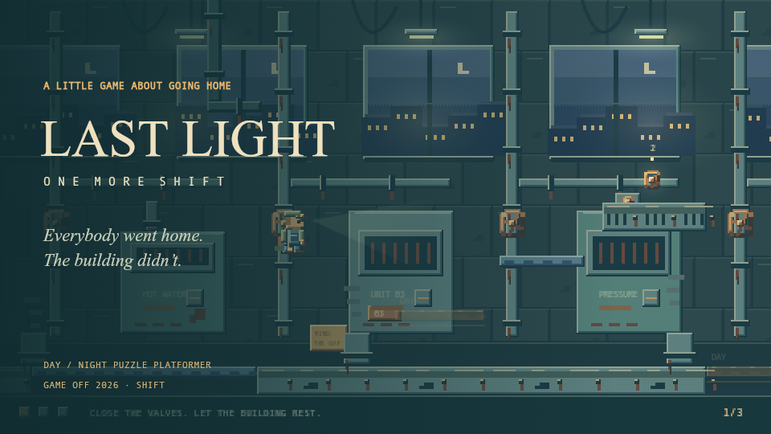

# LAST LIGHT · One More Shift

Everybody went home. The building didn’t.

You are the last janitor in a building that changes after dark. Close the boiler valves, leave Gary his forgotten lunch, water the rooftop plants — and find your way home. A small puzzle platformer for **GitHub Game Off 2026: SHIFT**.



**Theme:** change the day/night shift with the Shift key. Gold machinery works by day; blue shadow bridges exist at night. The same melody and building have two rhythms.

## Play

**[Play in your browser](https://tomhao.itch.io/last-light)** · **[Official Game Off entry](https://itch.io/jam/game-off-2026/rate/5327077)**

No runtime dependencies, network requests, accounts or downloads. Serve `dist/` with any static server:

```sh
python3 -m http.server 8786 -d dist
```

Open http://localhost:8786. Modern Chrome, Edge, Firefox or Safari with Canvas 2D and WebAudio. Audio begins after your first click. English and Chinese story text, touch controls, local progress, forgiving checkpoints, coyote time and jump buffering.

- **A/D or ←/→:** move
- **Space / W / ↑:** jump; release for a shorter jump
- **Shift / X / the Shift button:** change the building
- **E / ↓:** use the elevator after all three tasks
- **M:** mute; **Esc:** pause. Losing focus pauses and mutes automatically.

A first playthrough is intended to take about 5–8 minutes; this is a design estimate, not a measured user study.

## The craft

All artwork is drawn in code at 480×270 and scaled with nearest-neighbor sampling. Materials use four-step colored ramps and upper-left lighting. Bolts streak rust downwards; dust rests on top edges. Boiler, office and roof dressing share a palette. The janitor has four idle phases with a blink, six run phases, distinct ascent/descent poses, two landing squash phases and delayed cap/keychain motion. Far skyline, middle machinery and near pipes scroll independently. Night adds lamp pools, headlamp light and a glowing exit.

All audio is synthesized locally. `audio.js` contains a tiny kick/tick/clunk/whirr/buzz/slurp kit, surface-aware randomized footsteps, one-second shift sound, floor ambience and micro-events. Day and night use the same composition with two arrangements. Phase gains crossfade over 0.18 seconds, music ducks 3 dB during the shift and door, and the exit has a 0.3-second near-silence setup. A compressor and limiter follow the master gain.

## Source and verification

`dist/core.js` is the deterministic physics model. `dist/game.js` owns input, story, tasks, saves and transitions. `dist/art.js` and `dist/audio.js` own the visual and sound direction. `tests/` covers the actual staircase, bridges, landing, coyote time and safe spawns.

```sh
npm ci
npm test
npm run check
node scripts/render-media.mjs
node scripts/render-audio.mjs
```

Development tools are optional; players download only the static files in `dist/`. The media scripts render actual game artwork and an offline audio review, not fake gameplay footage. See [verification](docs/VERIFICATION.md).

## Credits and AI disclosure

Created for this jam in November 2026 with AI assistance for programming, procedural pixel artwork, synthesized music/SFX, English/Chinese writing and testing. The pixel art is code-authored; it is **not claimed to be manually hand-pixelled by a human**. No external art, samples, fonts, recorded voices, testimonials or pre-existing game code are included. The story is fictional. All source and original game content are offered under the MIT license. Development package licenses remain with their authors.

Author / entrant: Tomhao10225101490. No impersonation or synthetic narration.
